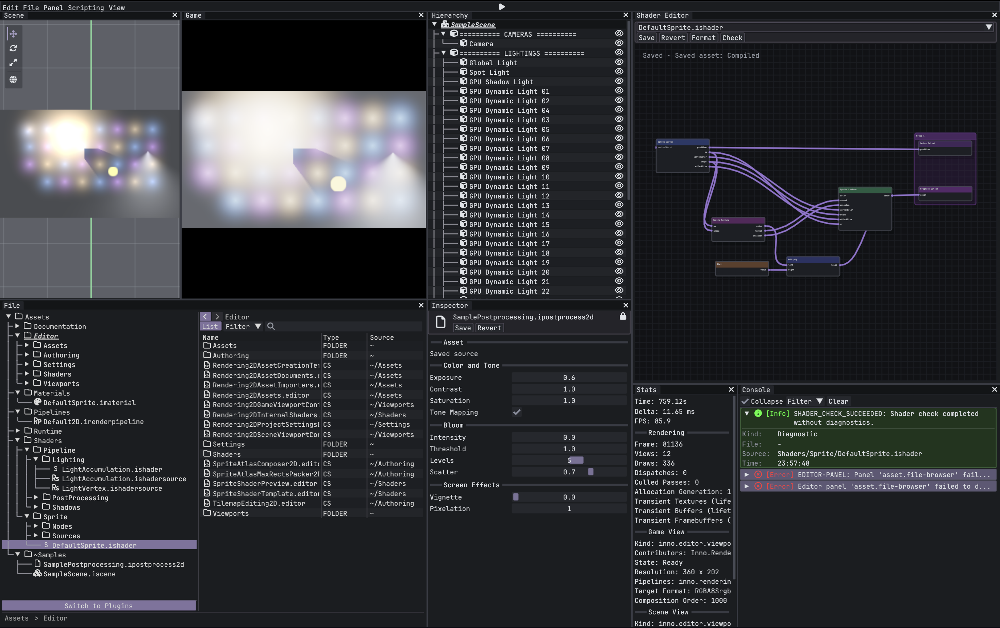

# InnoEngine

**Innovate As You Want.** A plugin-oriented game engine written in C#.

Build your game's rendering models, gameplay systems, and Editor tools on a shared foundation. InnoEngine provides backend-neutral mechanisms, explicit platform composition, and a common asset and plugin workflow.

[Get started](#get-started) · [Wiki](docs/README.md) · [Architecture](docs/architecture/ENGINE_ARCHITECTURE_OVERVIEW.md) · [Extend the engine](docs/architecture/PLATFORM_EXTENSION_GUIDE.md)



> Active development. APIs and project data evolve together. See [current validation and limitations](docs/architecture/CURRENT_ACCEPTANCE.md) before relying on a product path.

## Get started

**Requirements:** Git, the project's .NET 9 SDK, and the Native SDK for your host: Visual Studio C++ / Windows SDK on Windows x64, or Xcode command line tools on macOS ARM64.

```sh
git clone --recurse-submodules https://github.com/Wolfiora/InnoEngine.git
cd InnoEngine
```

Open **InnoEngine.sln** in Rider or Visual Studio. Choose one of two startup projects:

| Start | What it does |
|---|---|
| **InnoEngine.Editor** | Starts the validated prepared Editor and opens a project-folder picker; builds on first preparation. |
| **InnoEngine.Build** | Incrementally prepares the host Editor. Cleaning requires an explicit command or `--clean`. |

The same commands work from a terminal:

```sh
dotnet run --project "entry/InnoEngine.Build/InnoEngine.Build.csproj"
dotnet run --project "entry/InnoEngine.Editor/InnoEngine.Editor.csproj"
```

BindGen-CS is a pinned source submodule under `dependencies/`; a separate sibling checkout is unnecessary. A plain clone initializes missing submodules on the first entry run. Initial preparation needs network access and can take time.
After changing engine or backend source, run InnoEngine.Build. Prepared Editor startup validates its deployed files and does not invoke MSBuild or native compilers. Game scripts and assets use the Editor's import and reload workflow. Player support packs are prepared separately when exporting a game or requesting `support-pack`.

Have a project already? Pass its directory after `--`. To try FlappyBird, clone [InnoEngine.Samples](https://github.com/Wolfiora/InnoEngine.Samples) separately and select its FlappyBird folder. Linux currently offers Native tooling rebuilds; an Editor has not been implemented.

[Startup, advanced commands, and game exports →](docs/platform/PRODUCT_STARTUP.md) · [Current acceptance](docs/architecture/CURRENT_ACCEPTANCE.md)

## Product targets

| Target | Products | Managed deployment |
|---|---|---|
| Windows x64 | Editor, Player | CoreCLR, NativeAOT |
| macOS ARM64 | Editor, Player | CoreCLR, NativeAOT |
| Browser Wasm32 / WebGL 2 | Player | Mono Wasm, Mono Wasm AOT |

The current build/cache refactor still requires the Windows and Web product matrix to be rerun. macOS needs validation on a macOS host. GUI, DPI, and audio device checks are tracked separately; Linux currently contributes native tooling only.

## Built to compose

- **Shared mechanisms.** Identity, serialization, events, assets, scenes, rendering, audio, input, storage, and execution lifecycles.
- **Replaceable implementations.** SDL3, BGFX, MiniAudio, FreeType/HarfBuzz, RmlUi, and ImGui live in reusable backends. Platform integrations connect actual SDK differences.
- **Explicit ownership.** Sessions own resources; candidate publication, Missing recovery, and verified generation retirement support hot reload.
- **Plugins shape the engine.** Rendering models, components, importers, and Editor tools share the same discovery and authoring infrastructure.

Author under `Assets/`; install `.iplugin` packages under `Plugins/`. Installed plugin content enters the existing asset pipeline as read-only sources. [Plugin workflow →](docs/plugins/Inno.Plugins.Authoring.md)

```text
entry/       Two development launchers and host dispatch
dependencies/ Pinned independent source dependencies
src/         Shared foundation, content, services, runtime, and product hosting
backends/    Reusable adapters, native bindings, and component build recipes
platforms/   System/SDK integration, product entry points, and packaging
build/       Common pipelines, toolchains, and explicit distribution composition
tests/       Domain and cross-component contract tests
extern/      Third-party source dependencies
docs/        Architecture, workflows, and API Wiki
```

New platforms select backends and supply the required integrations. New backends implement domain contracts and join the explicit product/build composition. [Extension guide →](docs/architecture/PLATFORM_EXTENSION_GUIDE.md)

## Learn more

| Start here | Find |
|---|---|
| [API Wiki](docs/README.md) | Project pages and public contracts |
| [Scripting](docs/scripting/README.md) | Game code and extension APIs |
| [Build](docs/build/README.md) | CLI, native toolchains, and game exports |
| [Architecture](docs/architecture/ENGINE_ARCHITECTURE_OVERVIEW.md) | Layers, dependencies, and ownership |

## License

[Apache License 2.0](LICENSE). Third-party dependencies retain their respective licenses.
