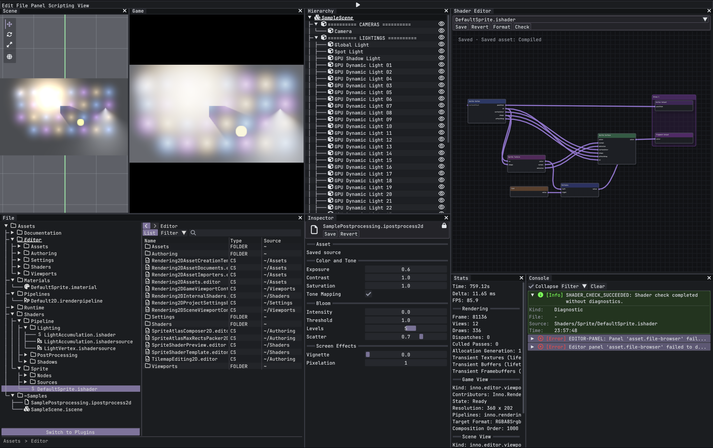

  

# InnoEngine

**Innovate As You Want.** A plugin-oriented game engine written in C#.

InnoEngine combines shared mechanisms for assets, scenes, scripting and resource lifetimes with replaceable backends and explicit platform products. Game systems and Editor extensions use the same discovery and authoring infrastructure.

| Start here | Find |
| --- | --- |
| [Get started](https://github.com/Wolfiora/InnoEngine.Docs/tree/main/content/en/getting-started) | Host prerequisites, first Editor session and project workflow |
| [Documentation](https://github.com/Wolfiora/InnoEngine.Docs/tree/main/content/en) | English task manuals, design explanations and API contracts |
| [Architecture](https://github.com/Wolfiora/InnoEngine.Docs/tree/main/content/en/architecture) | Module responsibilities, dependency direction and ownership |
| [Development](https://github.com/Wolfiora/InnoEngine.Docs/tree/main/content/en/contributing) | Building, validation, local documentation queries and platform extensions |
| [Contributing](CONTRIBUTING.md) | The shared development rules for humans and agents |
| [Acceptance and limitations](.agents/records/acceptance/current.md) | Exact evidence scopes and outstanding checks |

APIs and project data evolve together during active development. Product support and device validation are separate; consult the linked acceptance records for the relevant commit and environment.

[Apache License 2.0](LICENSE) applies to the engine source code. [Bundled fonts](assets/fonts/README.md#licenses) retain their respective licenses. The [Logo and derived icon font](assets/branding/LICENSE.txt) have a separate license permitting use only with InnoEngine.

## API synchronization and documentation CI

After a human merge to `master`, the independent API workflow compares committed input membership and identities before starting SDK preparation or its Windows/macOS matrix. Matching trusted inputs produce `NoRelevantChanges`. Unknown relationships, new sources, imports and generator changes require actual project evaluation. Each owner/context reuses only matching immutable extraction payloads; the final package is always complete.

Identical API/XML/source-location facts do not change the Docs binding, merge branch ancestry, create a commit or push `draft`. Changed facts are imported atomically while preserving manual explanations. Engine functional, Native and product acceptance remain independent and unchanged.

Docs `draft` pushes and PRs into `draft` check affected pages and dependencies; they do not normally build the entire site. A human `draft → main` PR validates the complete merge candidate and creates one site artifact. After merge, main publishes that exact artifact when trusted publication inputs match; otherwise it validates once. See the [Docs workflow guide](https://github.com/Wolfiora/InnoEngine.Docs#what-ci-checks-and-why-jobs-can-be-skipped).
