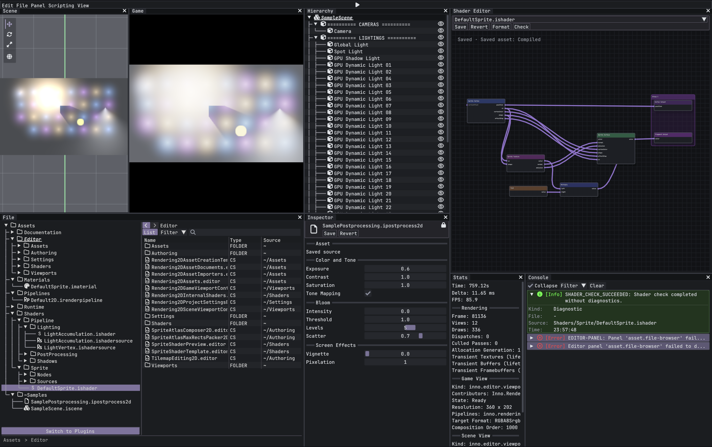

# InnoEngine

**Innovate As You Want.** A plugin-oriented game engine written in C#.

InnoEngine combines shared mechanisms for assets, scenes, scripting and resource lifetimes with replaceable backends and explicit platform products. Game systems and Editor extensions use the same discovery and authoring infrastructure.

| Start here | Find |
| --- | --- |
| [Get started](docs/getting-started/README.md) | Host prerequisites, first Editor session and project workflow |
| [Documentation](docs/README.md) | Design, implementation, usage and API contracts |
| [Architecture](docs/architecture/README.md) | Module responsibilities, dependency direction and ownership |
| [Development](docs/development/README.md) | Building, validation, local documentation queries and platform extensions |
| [Contributing](CONTRIBUTING.md) | The shared development rules for humans and agents |
| [Acceptance and limitations](.agents/records/acceptance/current.md) | Exact evidence scopes and outstanding checks |

APIs and project data evolve together during active development. Product support and device validation are separate; consult the linked acceptance records for the relevant commit and environment.

[Apache License 2.0](LICENSE). Third-party dependencies retain their respective licenses.
