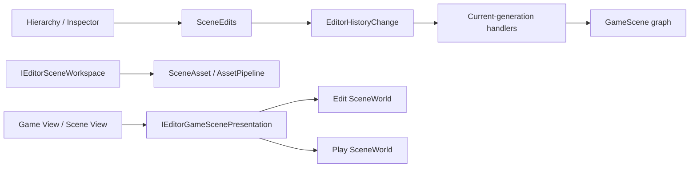

# Inno.Editor.Scene

[Editor 索引](README.md) · [Interactions](Inno.Editor.Interactions.md) · [Scene](../scene/Inno.Scene.md)

`Inno.Editor.Scene` 是 Scene 领域的 Editor feature，不是 Panel。它拥有 Scene document workspace、统一的 `SceneEdits` 修改门面，以及把 Scene 修改解释为中立 Undo/Redo payload 的 Handler。Hierarchy 和 Inspector 只负责收集用户意图与绘制，不再各自实现 Scene 快照或恢复算法。

## 边界与依赖



- `IEditorSceneWorkspace` 是当前 Edit/Play presentation 与 Open/Save 工作流契约；internal `EditorSceneWorkspace` Module 管理 Edit 文档、source path、dirty baseline、selection 映射与 `editor.ini` 状态。
- `IEditorGameScenePresentation` 是 Game View 与 Scene View 的只读游戏场景来源；它在 Play 世界完整物化成功后才从 Edit SceneWorld 原子切换到 Play SceneWorld。
- `SceneEdits` 是 Scene 内容修改的唯一高层入口，负责“修改成功后记录最小可逆数据”。
- History Handler 根据 persistent ID 和 Stable Type ID 在当前 generation 重新解析对象，不保留旧实例。
- `Inno.Scene` 提供通用 property/subtree/element 序列化能力，但不知道 Editor History；`Inno.Scene.Assets` 只负责导入器。
- Scene feature 通过 [Inno.Editor.Core](Inno.Editor.Core.md) 中 `EditorReloadCoordinator` 的中立 participant contract 接入 assembly reload，并自行拥有 Scene migration、Coroutine 清理和 Missing/reload diagnostics；`Inno.Editor.Scripting` 不引用 Scene 项目或 Scene 类型。
- `EditorReloadCoordinator.Register` 返回的 registration lease 强持有 participant，而 Coordinator 只保留弱引用。只要 Workspace 持有 lease，GC 就不能移除 Scene migration；Workspace Dispose 会注销并释放 participant，避免新 TypeCache 激活后仍遗留旧 collectible `Type` 的 Component/System。该所有权契约适用于所有 Editor reload feature，不是 Scene 私有补丁。

## 公共 API

### IEditorSceneWorkspace

| 成员 | 作用 |
| --- | --- |
| `scenes` / `activeScene` | Edit 时查询 authoring Scene；Play 时查询同 persistent ID 的 runtime copy。 |
| `canPersist` | 当前 Scene 是否是可保存的 Edit 文档；Play runtime copy 为 `false`。 |
| `Open(path)` | additive 打开 Scene asset。 |
| `Save(scene, directory)` | 保存到已有 source；未保存 Scene 在调用方提供的 fallback directory 创建 Asset。 |
| `SaveToDirectory(scene, directory)` | 显式保存到目标 Asset directory。 |
| `SavePrefab(gameObject, directory)` | 从 GameObject 子树保存 PrefabAsset。 |
| `IsDirty(scene)` | Edit 时比较序列化 hash、source path 与文件名；Play copy 恒为 `false`。比较或 source 同步失败时保守返回 dirty，并发布 Scene Diagnostic。 |
| `TryGetSourcePath(scene, out path)` | 查询保存后的 source-relative path。 |

具体 `EditorSceneWorkspace`、构造函数、Create/Close/Clear/Refresh 和 history/document helpers 均为 internal；可逆的 Scene 文档修改必须经 `SceneEdits`。该 Module 通过标准 protected Capture/Restore hooks 只把已保存 Scene 的顺序与 active Scene 写入 `[InnoEditor][Module.scene-workspace]`。Selection 属于当前 Editor session，不写入项目设置。未保存 Scene 内容和 dirty 内存同样不会写入 `editor.ini`；它们必须保存为 `.iscene`。

Scene setup 因缺少 Stable Type ID 或反序列化失败而暂时无法恢复时，Workspace 保留 pending setup 并发布 `Scene Workspace Restore` Diagnostic。TypeCache generation 或 Asset Database 变化后会重新尝试，成功才清除。每帧可重试的 document synchronization 使用 Scene persistent ID 维护独立 Diagnostic；相同异常只在首次出现时写入 Log，恢复、关闭 Scene 或停止 Workspace 都会清理对应状态。Missing Scene 被明确跳过属于历史事件，因此只写 Log warning。

`IsDirty` 的序列化比较失败另在 `Scene Dirty Check` 组发布诊断；下一次成功比较后清除。它仍按现有 0.1 秒节流做完整序列化 hash，以保持任意脚本或 Inspector 改动都能被观察，不把未覆盖的变更通知机制伪装成可靠 dirty 结果。

Asset Browser 移动或重命名已加载 Scene 的 source（包括移动其父目录）时，Workspace 会同步 document path、persistent source identity 与 Scene 显示名。source relocation 是文件元数据变化，不是 Scene 内容编辑：`IsDirty` 会先消费已提交的 source move，因此同一 UI frame 的 Hierarchy 绘制也不会短暂出现 `*`；原本 clean 的文档在同步显示名后重建保存基线，原本 dirty 的文档则保持 dirty，移动操作不会掩盖已有内容修改。

dirty baseline 也不会把任意 Asset 引用的 `lastKnownPath` 当成 Scene 内容。Scene/Prefab 的真实落盘仍保留该路径提示，但 Workspace 的语义 hash 只比较 persistent asset identity、Stable Type ID 与 Scene property state。因此 File Browser 对 SceneAsset 或其他被引用 Asset 的 Rename/Move 不会使引用它的 loaded Scene 显示 `*`；引用被用户替换为另一个 persistent asset 才属于真实内容变化。

脚本 Component/System 在 reload 中进入或退出 Missing 同样不是用户数据编辑。Scene serializer 保持原逻辑类型与 property payload 的规范表示；Workspace reload participant 还会在迁移前强制判定每个文档原本是否 dirty，并在整次迁移成功后只为原本 clean 的文档重建保存基线。因此即使恢复后的脚本增加了带默认值的序列化属性，Hierarchy 也不会把 generation migration 显示成用户造成的 `*`。原本 dirty 的文档绝不会被 rebase 掩盖，Missing 期间对其他 Scene 数据的真实修改仍正常保持 dirty、可以保存，并且不会破坏未来的原位恢复。恢复是否完整由原子 reload 事务和精确 diagnostics 判断，而不复用 dirty 标记：构造、属性或引用恢复不兼容会报告对应问题；事务失败则恢复旧 generation 与旧 dirty baseline。

Scene Missing 是当前状态诊断，而不是 Scripting 编译诊断。Workspace 启动、loaded Scene 集合变化或 TypeCache generation 变化后的下一次主线程更新，会完整替换 `Missing Scene Scripts` 诊断组；因此刚打开的 Scene 若含 Missing 会立即出现在 Console，类型恢复或 Scene 关闭后也会被清除。协调 reload 的成功、失败恢复与无变化 diagnostics refresh 由 Scene 自己响应，不要求 Scripting 理解 Scene。

### IEditorGameScenePresentation

这是 viewport presentation 与 Scene owner 之间唯一的 Edit/Play 场景协议：

| 成员 | 作用 |
| --- | --- |
| `Capture()` | 返回调用者必须释放的共享 `ContentReadScope`，不强持有 Scene 或 session。 |
| `ContentReadScope.contents` / `activeContent` | 同一次捕获的有序 Identity 值与可空 active persistent ID。 |
| `GetValues<GameScene>()` / `TryGetValue<GameScene>(...)` | 在当前操作内经过 Identity domain 与 runtime generation 校验再解析对象；退休后的旧 identity 不会跳转到新 session。 |

该接口不暴露 `RuntimeSession`、可切换 setter、Rendering 类型或生命周期操作。Viewport 直接把同一个 scope 交给 Rendering 消费，不再复制整组 GameScene 引用。`using ContentReadScope content = presentation.Capture();` 的使用者必须在本次操作内复制需要的领域值并释放 scope，不得缓存解析出的 live object。Play lease 退出只切换 presentation；Scene 的真正退休仍由 RuntimeSession 完成。Hierarchy、Inspector 和 Scene Action 通过 `IEditorSceneWorkspace`/`SceneEdits` 操作当前 world。Play 修改只进入 runtime copy 与临时 History 分支，Edit 文档所有权没有转移。

### IEditorScenePlayMode

该公开接口是 [Play Mode](Inno.Editor.PlayMode.md) 的跨程序集基础设施，不是普通 Scene 编辑入口：

| 成员 | 作用 |
| --- | --- |
| `BeginPlayMode(runtimeSession)` | 捕获完整 Edit scene setup，把同 persistent ID 的独立对象图物化到 Play `RuntimeSession`，提交 presentation/selection 切换并返回幂等 lease。 |
| 返回 lease 的 `Dispose()` | 停止向 Game View 与 Scene View 呈现 Play Scene；Edit Scene 从未被替换，因此无需反序列化恢复。 |

物化是候选事务：目标 world 非空、快照捕获失败或任一 Scene 反序列化失败时，会清空候选 Play world，所有 Editor feature 继续指向 Edit world。只有全部 Scene、顺序和 active Scene 都准备完成后才发布 Play lease，并按 persistent ID 把 Selection 映射到 runtime copy。`CanEdit` 对当前 Play world 中的 Project scene 与临时 scene 返回 true，Inspector、Hierarchy 和 Scene gizmo 可通过 `SceneEdits` 修改运行副本；同 persistent ID 的 Edit world 对象不因此变成可编辑目标。Play History 使用独立分支，退出时销毁 Play world 和该分支，原 Edit world 与 Undo/Redo 状态恢复。Play session 活动期间 Workspace 不消费 Asset source change、不把 runtime graph 写入 `editor.ini`，并禁止 Scene/Prefab Open/Save；排队的 source change 在退出后才应用到始终保留的 Edit 文档。

### SceneEdits

| 分类 | 成员 |
| --- | --- |
| Scene 文档 | `CreateScene`、`CloseScene`、`SetSceneIndex` |
| GameObject | `CreateGameObject`、`InstantiatePrefab`、`DeleteGameObject`、`RenameGameObject`、`SetGameObjectActive`、`SetGameObjectTag`、`SetGameObjectLayer`、`ChangeHierarchy` |
| Component | `AddComponent`、`RemoveComponent`、`ResetComponent`、`SetComponentIndex` |
| System | `AddSystem`、`RemoveSystem`、`ResetSystem`、`SetSystemIndex` |
| 属性 | `ChangeProperty` |

Action 只需要注入该 Module：

```csharp
using Inno.Editor.Interactions;
using Inno.Editor.Scene;
using Inno.Scene;
using Inno.Scene.Components;

public sealed class MarkerBehavior : GameBehavior { }

[EditorAction("example.add-marker", "scene/hierarchy")]
public sealed class AddMarkerAction(SceneEdits edits) : EditorAction<GameObject>
{
    protected override void Execute(EditorActionContext<GameObject> context)
        => edits.AddComponent(context.target, typeof(MarkerBehavior), "Add Marker");
}
```

`InstantiatePrefab` 使用当前 workspace 的 Serialization/Asset generation，在 active Scene（或显式 scene/parent）中创建实例，并把完整新 subtree 记录为一次可撤销编辑；失败会销毁尚未记录的实例。File Browser 的 Prefab 双击和右键 Instantiate 都调用这一个入口。扩展不需要知道 History protocol、序列化格式或 Handler。若未来 Animation Graph 有自己的数据模型，应由 Animation Editor Module 采用相同模式提供 `AnimationEdits`，而不是把 Animation 特例塞进 `SceneEdits`。

## 最小历史数据

| 修改 | payload |
| --- | --- |
| serializable property | target persistent ID、root property key、before/after property bytes |
| name / active / tag | target persistent ID、scalar kind、before/after value |
| Component/System | owner、element persistent ID、Stable Type ID、before/after index、property bytes、incoming references |
| GameObject create/delete | Scene/root/parent ID、sibling index、仅该 subtree bytes、incoming references |
| hierarchy | 受影响对象的 before/after parent ID 与 sibling index |
| Scene order | Scene persistent ID 与两个 index |
| Scene create/close | 一个 document 的 Scene bytes、source identity、dirty baseline、active/selection IDs |

因此修改一个 `int` 不会序列化整张 Scene。只有删除一棵 GameObject 子树或关闭一个 Scene document 时，payload 才与实际被移除的数据规模相关；超过 History inline threshold 后自动存到磁盘。

## 原子性与热重载

- Property/Scalar restore 在应用前捕获实际 rollback bytes/value，并检查严格恢复结果。
- Component/System 与 Subtree 同时捕获 element/subtree、index、parent、state 和受影响 incoming references；恢复任一步失败都会逆序删除候选并还原原引用。
- Hierarchy 与 Scene order 先捕获真实 placement/index；正向和反向 placement 都检查结构化结果。
- Scene document 把 loaded document、source path、active scene、dirty baseline 作为一个领域事务；Selection/焦点只在成功后 best-effort 通知，不决定 History 成败。
- `SceneEdits` 对 after capture、payload/blob 创建或 `RecordApplied` 失败执行严格 before rollback；补偿也失败时抛出包含两侧原因的聚合异常，禁止留下未记录修改。
- Subtree/Element Handler 的失败补偿以 persistent identity 的实际 postcondition 分类：目标仍注册且存活时必须返回 `statePreserved=false`；回调即使抛异常，只要目标已彻底移除就不会误报状态丢失。恢复新元素后的 incoming-reference 失败也同时检查引用回滚与元素清理两个结果。
- 类型由 Stable Type ID 在当前 TypeCache generation 解析。Undo 创建元素时类型 Missing 不再直接阻断，而是按原 ID/index/state 恢复 Missing Component/System；已存在占位的类型匹配使用其逻辑 Stable Type ID，不使用 placeholder 的实现类型。目标 owner 不可用、Handler 缺失或无法原子恢复时仍形成 barrier，原栈保持不变。
- Element History 保存统一 `SceneElementSerialization.CaptureState` 的中立 bytes，包含类型名、属性、Asset dependencies 和 Scene reference aliases。Missing 元素的删除、移动和 Undo 保留这些值；相同类型恢复后原 Redo 继续作用于同一 persistent ID。
- 脚本 reload 后中立 payload 保留，Handler Registry 切换到新 generation；History 不固定旧 ALC。

## 相关序列化 API

`ScenePropertySerialization`、`SceneSubtreeSerialization` 和 `SceneElementSerialization` 位于 [Inno.Scene](../scene/Inno.Scene.md)，不是 Importer 程序集。它们不引用 Editor。普通 property History 仍保存单 property-data；Element History 则使用独立元素状态封套，通过同一个 Core Serialization 和 owner context 编码，不序列化整个 Scene，也不增加 legacy reader。

## Scripting API

EditorScripts 显式 `using InnoEditor.Scene;` 后只看到 `IEditorSceneWorkspace` 与 `SceneEdits`。`IEditorScenePlayMode` 和 `IEditorGameScenePresentation` 是 host/Panel 协调协议，不在脚本清单中；Play 控制使用 `InnoEditor.PlayMode.IEditorPlayMode`。concrete Workspace、构造/关闭/清空/刷新 helper、History payload、引用扫描器和 Handler 不导出；工作流通过接口，所有可逆 Scene 数据修改通过 `SceneEdits`。

## 当前源码公开 API 清单

此清单对应当前 SDK 求值与源码符号；内部类型不构成公开 API。

<!-- api: T:Inno.Editor.Scene.EditorSceneWorkspaceFactory 340333171a509a385f4def75e26e99a52de90f6c88c49d5ca3736bf2409ea988 -->
<!-- api: M:Inno.Editor.Scene.EditorSceneWorkspaceFactory.Create(Inno.Runtime.RuntimeSession,Inno.Assets.Pipeline.AssetPipeline,Inno.Extensibility.Types.TypeCatalog,Inno.Core.Serialization.SerializationRegistry,Inno.Core.Logging.LogRouter,Inno.Editor.Interactions.IEditorSelectionCoordinator) 533a60e2b8bc7d4387b2d5f78bee1e5c0cb1ed78d2b8dc8f60c831293786e8b7 -->
<!-- api: T:Inno.Editor.Scene.EditorSceneWorkspaceHost 8c67c5db8dd95840f54acde4e269d9de42bee054237a6b7a18b3d15e33b01a29 -->
<!-- api: P:Inno.Editor.Scene.EditorSceneWorkspaceHost.workspace 3e8cb98b83eb3ce6a98db81d16e56b450b6a060727e42de12584a3341cab1f02 -->
<!-- api: P:Inno.Editor.Scene.EditorSceneWorkspaceHost.gamePresentation d4516d50a7f56cf549e40ddf44d0d28403a11ed72fe7fa1a3d4cac9d98630cca -->
<!-- api: P:Inno.Editor.Scene.EditorSceneWorkspaceHost.playMode 1f7271427f16ff07da3b9bec96ed5e56a2b9cdba67d997893c13930ee5e4799b -->
<!-- api: M:Inno.Editor.Scene.EditorSceneWorkspaceHost.Dispose 32d054976cdce836d230c83fcc75e93ccc4976dec570f4a1687afc5f53f50c41 -->
<!-- api: T:Inno.Editor.Scene.IEditorScenePlayMode 67870bc86817bce9857967388e27a2a97b58ccc488182d704dcccb8494e42a0c -->
<!-- api: M:Inno.Editor.Scene.IEditorScenePlayMode.BeginPlayMode(Inno.Runtime.RuntimeSession) 9cc557cb529a901b4c2fcb20810f05da6c33e2ea867dd686e1927384b811fd88 -->
<!-- api: T:Inno.Editor.Scene.IEditorSceneWorkspace 42c69697545ed60cb8e3bfbd4ed1a7049248d2e5ee907b816ddae218efe23080 -->
<!-- api: P:Inno.Editor.Scene.IEditorSceneWorkspace.scenes bc0f00fc0161e28a1da6f768bc7df1da81f7e4febb0724100feb4e170d9e58f1 -->
<!-- api: P:Inno.Editor.Scene.IEditorSceneWorkspace.activeScene 948ce51a24aab9f45f863e58ffadb4f34c733d6c43ec929c694bc6e497eaf24d -->
<!-- api: P:Inno.Editor.Scene.IEditorSceneWorkspace.canPersist 5a39e9a86219ee9bbbac8e8b33e701ea3402f496df340d470429dca166c77b7d -->
<!-- api: M:Inno.Editor.Scene.IEditorSceneWorkspace.CanEdit(Inno.Scene.GameScene) 79cf24356d2793bd9d2631fa883d547529a88225ef0c70b8b06e31a8a14561a3 -->
<!-- api: M:Inno.Editor.Scene.IEditorSceneWorkspace.SetActiveScene(Inno.Scene.GameScene) 56d2e06fbfeb04453c16d1f92477276ede76c628263d19514c167a04d986311d -->
<!-- api: M:Inno.Editor.Scene.IEditorSceneWorkspace.IsDirty(Inno.Scene.GameScene) 8adafc0ad0f33de41f5dbdf73003e06b580d271fc1e1715b4a56c5ba03678c35 -->
<!-- api: M:Inno.Editor.Scene.IEditorSceneWorkspace.Open(System.String) ec0c79f229efa4c086132fba1cccf18a6e79bde656cc9285ead8a7f80326b923 -->
<!-- api: M:Inno.Editor.Scene.IEditorSceneWorkspace.Save(Inno.Scene.GameScene,System.String) c46c5ba62b7ad071c46c51ef654df2ba6466ea9fa1777992dd85dfc2eaffd6c6 -->
<!-- api: M:Inno.Editor.Scene.IEditorSceneWorkspace.SaveToDirectory(Inno.Scene.GameScene,System.String) 5b1130c663734ed88456109ad84c85cfad2caab54cb8e33d3429310e226d213a -->
<!-- api: M:Inno.Editor.Scene.IEditorSceneWorkspace.SavePrefab(Inno.Scene.GameObject,System.String) 38330aa1e1381a47fc0475eee4d3129fdb1ead30829549b59117c488d08cbb7d -->
<!-- api: M:Inno.Editor.Scene.IEditorSceneWorkspace.TryGetSourcePath(Inno.Scene.GameScene,System.String@) 281c631be51558825fd906fb096a1728916e252822af4fddb4739ea0452ab34a -->
<!-- api: T:Inno.Editor.Scene.SceneEdits 083cf57af2a9f9b01a45be81acf1d54cc1eb2744e65e9daac4e665505ac5bbb7 -->
<!-- api: M:Inno.Editor.Scene.SceneEdits.CanEdit(Inno.Scene.GameScene) 863e27947c47d399a352e56bd17bec802944d14f64c26752fd7a353390d693d6 -->
<!-- api: M:Inno.Editor.Scene.SceneEdits.CanEdit(Inno.Scene.EngineObject) 30b3a83b924d53ff80414e382fda5f983f159f41faad400611422f2a7dafc95f -->
<!-- api: M:Inno.Editor.Scene.SceneEdits.CreateScene(System.String) cd23c7b02ca3d776e815958d9b52edd75b3750ab6d5bfa90cdc9742a08e5d0be -->
<!-- api: M:Inno.Editor.Scene.SceneEdits.CloseScene(Inno.Scene.GameScene,System.String) d67bc3d0d68bd3fd960b081a9c4dcd9ecfdb01e21f2c86fbf5baeb1b465afc1b -->
<!-- api: M:Inno.Editor.Scene.SceneEdits.AddComponent(Inno.Scene.GameObject,System.Type,System.String) 25f806eccdb9e405f099aa0553b5000229ba7f013529ac0ea0fc40b51ee38731 -->
<!-- api: M:Inno.Editor.Scene.SceneEdits.RemoveComponent(Inno.Scene.GameComponent,System.String) 6a9902911ba11303bbcb2fad65ebe8a463454e92e2133156d3e58914675911c0 -->
<!-- api: M:Inno.Editor.Scene.SceneEdits.ResetComponent(Inno.Scene.GameComponent,System.String) 2ac6e7f1f60b68afe4d2f5f76be973e42d18879545673cd2db2b2e9951290f77 -->
<!-- api: M:Inno.Editor.Scene.SceneEdits.SetComponentIndex(Inno.Scene.GameComponent,System.Int32,System.String) f8caf65c08b8019cddc5f48f2bc689de06aaad4d3da44d6171ba9c70cfd2a86f -->
<!-- api: M:Inno.Editor.Scene.SceneEdits.AddSystem(Inno.Scene.GameScene,System.Type,System.String) b1461b60525c682368d56dbee308e3a305e04d502868057a652657becea53261 -->
<!-- api: M:Inno.Editor.Scene.SceneEdits.RemoveSystem(Inno.Scene.GameSystem,System.String) 41f26d5db522c80a41a8c4847361574164186af4b40f7e5d256fc521caf6b84a -->
<!-- api: M:Inno.Editor.Scene.SceneEdits.ResetSystem(Inno.Scene.GameSystem,System.String) 1c5a313e36e38696f1a3a74a37898b596001e0791efcb8c2bb8fbafc407239a9 -->
<!-- api: M:Inno.Editor.Scene.SceneEdits.SetSystemIndex(Inno.Scene.GameScene,Inno.Scene.GameSystem,System.Int32,System.String) 18f361b2f01ccf8556fbec4310337f99330c6ba65c2c033c181356c552e4a9f6 -->
<!-- api: M:Inno.Editor.Scene.SceneEdits.SetSceneIndex(Inno.Scene.GameScene,System.Int32,System.String) 67937205f1a8180b2bf943c92afee3bb33a127140669ef2ea53cf6c429d555f3 -->
<!-- api: M:Inno.Editor.Scene.SceneEdits.ChangeHierarchy(Inno.Scene.GameObject,System.Action{Inno.Editor.Scene.SceneHierarchyEdit},System.String,System.Collections.Generic.IReadOnlyCollection{Inno.Scene.GameObject}) b0e1b83bc6776adba5cd2a53c13062844829d7da4d408c6b437c52f8ae38b81c -->
<!-- api: M:Inno.Editor.Scene.SceneEdits.CreateGameObject(Inno.Scene.GameScene,Inno.Scene.Components.Transform,System.String) 4f62871bf07e51d1873c4349995e973528547c6f24ae2ebf001499ed28ddfe8f -->
<!-- api: M:Inno.Editor.Scene.SceneEdits.InstantiatePrefab(Inno.Scene.PrefabAsset,Inno.Scene.GameScene,Inno.Scene.Components.Transform,System.String) db1f856bd7b810fc4f6cf29b1b6eefbfdc2741bb012690ddf6ac6d7301e499db -->
<!-- api: M:Inno.Editor.Scene.SceneEdits.DeleteGameObject(Inno.Scene.GameObject,System.String) 1817640516be9ac1b71cde06f346fd319a87cd20c5a58232735627cd076f1795 -->
<!-- api: M:Inno.Editor.Scene.SceneEdits.RenameScene(Inno.Scene.GameScene,System.String,System.String) 5a9256f2d408b47a23db98a716a0cac0a4e994ccd4a2fe04b3fa59511b7f8240 -->
<!-- api: M:Inno.Editor.Scene.SceneEdits.RenameGameObject(Inno.Scene.GameObject,System.String,System.String) dc133fab2657bb29dded3ab1dc6baee2a977241dc928bfdc92acc89116ad36d4 -->
<!-- api: M:Inno.Editor.Scene.SceneEdits.SetGameObjectActive(Inno.Scene.GameObject,System.Boolean,System.String) 0f9e076d48e2b18823beaf302733c2b805aa6646a3f6a8c08c8b53db76519cfa -->
<!-- api: M:Inno.Editor.Scene.SceneEdits.SetGameObjectTag(Inno.Scene.GameObject,System.String,System.String) d1dd7ab7128475a29ddbae3c06a243cf4ea1f19a042af8fffff93bbf7a61f376 -->
<!-- api: M:Inno.Editor.Scene.SceneEdits.SetGameObjectLayer(Inno.Scene.GameObject,Inno.Scene.Layers.GameLayer,System.String) b6e1bef64ffc3882cb7da22191ce60fa5a9275b7c86966530648d06e8d898c3f -->
<!-- api: M:Inno.Editor.Scene.SceneEdits.ChangeProperty(Inno.Scene.EngineObject,System.String,System.Action,System.String,System.String) 7eaa5d901320e5306399a28593ca702f215166b52dea0093ef9ad2d8c177ad56 -->
<!-- api: M:Inno.Editor.Scene.SceneEdits.DeleteGameObjects(System.Collections.Generic.IReadOnlyList{Inno.Scene.GameObject}) 437b2bb769155458050d8bbbbfe771b79eecb0155d4c27b4809129139e63a24b -->
<!-- api: M:Inno.Editor.Scene.SceneEdits.ChangeProperties(System.Collections.Generic.IReadOnlyList{Inno.Scene.EngineObject},System.String,System.Action,System.String,System.String,System.String) ed5a7531a71b7fc19950a6973cec04194f4418d90c734b55a57eae090bada674 -->
<!-- api: M:Inno.Editor.Scene.SceneEdits.HaveSamePropertyValues(System.Collections.Generic.IReadOnlyList{Inno.Scene.EngineObject},System.String) ce5b527fab6feec8566ae0201bcd6de8c83a00e7ce81d67e1d7def36cea48b10 -->
<!-- api: M:Inno.Editor.Scene.SceneEdits.MoveGameObjects(System.Collections.Generic.IReadOnlyList{Inno.Scene.GameObject},Inno.Scene.GameScene,Inno.Scene.GameObject,System.Int32) 5299c5ef0279f3a553dfd7ab4c80177a194a020646e1bc1d88b11bbecc111e7c -->
<!-- api: T:Inno.Editor.Scene.SceneHierarchyEdit 7178858bb9fa6114a9e77bc97f0dce944e9447863b3e60ff3baa7477b1f21938 -->
<!-- api: M:Inno.Editor.Scene.SceneHierarchyEdit.MoveToScene(Inno.Scene.GameObject,Inno.Scene.GameScene) b4f3f268e4c99947a94c2890cbcbbe58194f3b22c9ddd0effd767e38a24e2ff9 -->
<!-- api: T:Inno.Editor.Scene.IEditorGameScenePresentation 368984c2ee1e29a64dc671878d8f05e8d7e4236df8846c1f9f9f247050e7d639 -->
<!-- api: M:Inno.Editor.Scene.IEditorGameScenePresentation.Capture 561e2bb2221a3e7aaa4c8dabe08f0665739c2ec9ccd599e554bfabf49fcd7b3e -->

| API 与源码 | 契约与参数 | 返回值 | 重要异常 |
| --- | --- | --- | --- |
| <a id="api-aa4bdc7999df3984"></a>[`public static class Inno.Editor.Scene.EditorSceneWorkspaceFactory`](../../src/composition/editor/features/Inno.Editor.Scene/Documents/EditorSceneWorkspaceFactory.cs#L15) | Creates explicitly owned editor scene workspaces for embedded editor hosts and command-line tooling. | — | — |
| <a id="api-d24846f6693a6011"></a>[`public static Inno.Editor.Scene.EditorSceneWorkspaceHost Inno.Editor.Scene.EditorSceneWorkspaceFactory.Create(Inno.Runtime.RuntimeSession runtimeSession, Inno.Assets.Pipeline.AssetPipeline assets, Inno.Extensibility.Types.TypeCatalog types, Inno.Core.Serialization.SerializationRegistry serialization, Inno.Core.Logging.LogRouter logs, Inno.Editor.Interactions.IEditorSelectionCoordinator? selection = null)`](../../src/composition/editor/features/Inno.Editor.Scene/Documents/EditorSceneWorkspaceFactory.cs#L44) | Creates an unattached workspace over explicitly owned Edit-session services.<br>`runtimeSession`: The Edit session that owns the workspace scene world.<br>`assets`: The authoring asset pipeline used for scene and prefab documents.<br>`types`: The host type catalog used for scene extension generations.<br>`serialization`: The host serialization registry used for scene snapshots.<br>`logs`: The application log router used for workspace lifecycle diagnostics.<br>`selection`: The optional selection coordinator used by the standalone document workspace. | A host that owns both the document and Play Mode interfaces of the workspace. | `System.ArgumentNullException`: Thrown when a required owner is . |
| <a id="api-80d8bcb46d7b67b5"></a>[`public sealed class Inno.Editor.Scene.EditorSceneWorkspaceHost : System.IDisposable`](../../src/composition/editor/features/Inno.Editor.Scene/Documents/EditorSceneWorkspaceHost.cs#L17) | Owns an editor scene workspace created outside the attribute-discovered editor application. | — | — |
| <a id="api-2bc14f29cbcc873d"></a>[`public Inno.Editor.Scene.IEditorSceneWorkspace Inno.Editor.Scene.EditorSceneWorkspaceHost.workspace { get; }`](../../src/composition/editor/features/Inno.Editor.Scene/Documents/EditorSceneWorkspaceHost.cs#L43) | Gets the Edit-or-Play scene presentation and persistence boundary owned by this host. | — | — |
| <a id="api-6dddaf10786529d7"></a>[`public Inno.Editor.Scene.IEditorGameScenePresentation Inno.Editor.Scene.EditorSceneWorkspaceHost.gamePresentation { get; }`](../../src/composition/editor/features/Inno.Editor.Scene/Documents/EditorSceneWorkspaceHost.cs#L48) | Gets the Edit-or-Play rendering presentation boundary owned by this host. | — | — |
| <a id="api-d8d57bc49cc6f965"></a>[`public Inno.Editor.Scene.IEditorScenePlayMode Inno.Editor.Scene.EditorSceneWorkspaceHost.playMode { get; }`](../../src/composition/editor/features/Inno.Editor.Scene/Documents/EditorSceneWorkspaceHost.cs#L53) | Gets the isolated Play Mode scene-session boundary owned by this host. | — | — |
| <a id="api-af66fc6dfe0863e7"></a>[`public void Inno.Editor.Scene.EditorSceneWorkspaceHost.Dispose()`](../../src/composition/editor/features/Inno.Editor.Scene/Documents/EditorSceneWorkspaceHost.cs#L58) | Releases the workspace and any isolated scene session that it still owns. | — | — |
| <a id="api-c5e84225c81d3a60"></a>[`public interface Inno.Editor.Scene.IEditorScenePlayMode`](../../src/composition/editor/features/Inno.Editor.Scene/Documents/IEditorScenePlayMode.cs#L10) | Creates isolated runtime scene sessions from the current editable scene set. | — | — |
| <a id="api-e80a50bf67731932"></a>[`System.IDisposable Inno.Editor.Scene.IEditorScenePlayMode.BeginPlayMode(Inno.Runtime.RuntimeSession runtimeSession)`](../../src/composition/editor/features/Inno.Editor.Scene/Documents/IEditorScenePlayMode.cs#L30) | Captures the editable scene set and materializes independent runtime copies in the supplied session.<br>`runtimeSession`: The isolated Play Mode session that receives the immutable start snapshot and owns editor-side operations performed against the runtime copies. | A lease that presents the runtime copies to editor features, prevents their persistence, and restores the Edit presentation when disposed. | `System.ArgumentNullException`: Thrown when is null.<br>`System.InvalidOperationException`: Thrown when another Play Mode lease is active, the target world is not empty, or the snapshot cannot be materialized atomically. |
| <a id="api-406cc6a3fe33e247"></a>[`public interface Inno.Editor.Scene.IEditorSceneWorkspace`](../../src/composition/editor/features/Inno.Editor.Scene/Documents/IEditorSceneWorkspace.cs#L10) | Exposes the active Edit or Play scene presentation and the persistence operations available to it. | — | — |
| <a id="api-e6fad988f5bc627b"></a>[`System.Collections.Generic.IReadOnlyList<Inno.Scene.GameScene> Inno.Editor.Scene.IEditorSceneWorkspace.scenes { get; }`](../../src/composition/editor/features/Inno.Editor.Scene/Documents/IEditorSceneWorkspace.cs#L15) | Gets the Edit scenes outside Play Mode or the isolated runtime copies while Play Mode is active. | — | — |
| <a id="api-110d39ec989eb6ce"></a>[`Inno.Scene.GameScene? Inno.Editor.Scene.IEditorSceneWorkspace.activeScene { get; }`](../../src/composition/editor/features/Inno.Editor.Scene/Documents/IEditorSceneWorkspace.cs#L20) | Gets the active scene from the currently presented Edit or Play world. | — | — |
| <a id="api-b6df95e0699576e5"></a>[`bool Inno.Editor.Scene.IEditorSceneWorkspace.canPersist { get; }`](../../src/composition/editor/features/Inno.Editor.Scene/Documents/IEditorSceneWorkspace.cs#L25) | Gets whether the currently presented scenes are authoring documents that may be persisted. | — | — |
| <a id="api-e9f8b9e75fa73fb4"></a>[`bool Inno.Editor.Scene.IEditorSceneWorkspace.CanEdit(Inno.Scene.GameScene scene)`](../../src/composition/editor/features/Inno.Editor.Scene/Documents/IEditorSceneWorkspace.cs#L37) | Gets whether a loaded scene may be changed in the current Edit or isolated Play world.<br>`scene`: The scene to inspect. | for a writable Project scene or transient scene in the presented world. Changes made during Play remain in the runtime copy and are discarded on stop. | — |
| <a id="api-26bd6a16b11b8424"></a>[`void Inno.Editor.Scene.IEditorSceneWorkspace.SetActiveScene(Inno.Scene.GameScene scene)`](../../src/composition/editor/features/Inno.Editor.Scene/Documents/IEditorSceneWorkspace.cs#L51) | Makes one presented scene active without changing scene order.<br>`scene`: The loaded scene to activate. | — | `System.ArgumentNullException`: Thrown when is .<br>`System.InvalidOperationException`: Thrown when the scene is not loaded by this workspace. |
| <a id="api-cd287324b83a0647"></a>[`bool Inno.Editor.Scene.IEditorSceneWorkspace.IsDirty(Inno.Scene.GameScene scene)`](../../src/composition/editor/features/Inno.Editor.Scene/Documents/IEditorSceneWorkspace.cs#L63) | Gets whether an Edit scene contains unsaved serialized changes.<br>`scene`: The scene to inspect. | when an Edit scene differs from its saved baseline; runtime copies always return because they cannot be persisted. | — |
| <a id="api-3fcb4d05de69ed42"></a>[`Inno.Scene.GameScene Inno.Editor.Scene.IEditorSceneWorkspace.Open(string relativePath)`](../../src/composition/editor/features/Inno.Editor.Scene/Documents/IEditorSceneWorkspace.cs#L77) | Opens a scene asset additively as the active editor scene.<br>`relativePath`: The source-relative scene asset path. | The existing loaded instance or newly loaded scene. | `System.InvalidOperationException`: Thrown while Play Mode runtime copies are active or when the asset cannot be opened. |
| <a id="api-c949db2065c17e46"></a>[`string Inno.Editor.Scene.IEditorSceneWorkspace.Save(Inno.Scene.GameScene scene, string currentDirectory)`](../../src/composition/editor/features/Inno.Editor.Scene/Documents/IEditorSceneWorkspace.cs#L94) | Saves a scene to its existing path or into a fallback directory.<br>`scene`: The scene to save.<br>`currentDirectory`: The fallback asset directory for an unsaved scene. | The saved source-relative path. | `System.InvalidOperationException`: Thrown while Play Mode runtime copies are active or when the asset cannot be persisted. |
| <a id="api-3588badbbe4499bb"></a>[`string Inno.Editor.Scene.IEditorSceneWorkspace.SaveToDirectory(Inno.Scene.GameScene scene, string currentDirectory)`](../../src/composition/editor/features/Inno.Editor.Scene/Documents/IEditorSceneWorkspace.cs#L114) | Saves a scene into the requested asset directory.<br>`scene`: The scene to save.<br>`currentDirectory`: The target asset directory. | The saved source-relative path. | `System.InvalidOperationException`: Thrown while Play Mode runtime copies are active or when the asset cannot be persisted. |
| <a id="api-cae7cf9d82f7f10e"></a>[`string Inno.Editor.Scene.IEditorSceneWorkspace.SavePrefab(Inno.Scene.GameObject gameObject, string currentDirectory)`](../../src/composition/editor/features/Inno.Editor.Scene/Documents/IEditorSceneWorkspace.cs#L134) | Captures a game object subtree as a prefab in the requested directory.<br>`gameObject`: The prefab root.<br>`currentDirectory`: The target asset directory. | The saved source-relative path. | `System.InvalidOperationException`: Thrown while Play Mode runtime copies are active or when the asset cannot be persisted. |
| <a id="api-cd499520eefdd4b4"></a>[`bool Inno.Editor.Scene.IEditorSceneWorkspace.TryGetSourcePath(Inno.Scene.GameScene scene, out string relativePath)`](../../src/composition/editor/features/Inno.Editor.Scene/Documents/IEditorSceneWorkspace.cs#L151) | Tries to get the current source-relative asset path of a saved scene.<br>`scene`: The scene whose path is requested.<br>`relativePath`: The saved path when available. | when the scene is backed by a scene asset. | — |
| <a id="api-40bd2d84f306e5e5"></a>[`public sealed class Inno.Editor.Scene.SceneEdits : Inno.Editor.Core.EditorModule`](../../src/composition/editor/features/Inno.Editor.Scene/Documents/SceneEdits.cs#L20) | Applies scene-document mutations and records compact, reload-safe inverse data in editor history. | — | — |
| <a id="api-a94c8ab313cda2ea"></a>[`public bool Inno.Editor.Scene.SceneEdits.CanEdit(Inno.Scene.GameScene scene)`](../../src/composition/editor/features/Inno.Editor.Scene/Documents/SceneEdits.cs#L52) | Gets whether the scene is editable in the current Edit or isolated Play world.<br>`scene`: The loaded scene to inspect. | when scene commands may change this scene. Play changes use a temporary history branch and are discarded when the Play session ends. | — |
| <a id="api-94d2e3c8fca048f2"></a>[`public bool Inno.Editor.Scene.SceneEdits.CanEdit(Inno.Scene.EngineObject target)`](../../src/composition/editor/features/Inno.Editor.Scene/Documents/SceneEdits.cs#L63) | Gets whether a scene object belongs to an editable presented scene.<br>`target`: The scene object to inspect. | when its owning scene is writable. | — |
| <a id="api-10fe40e9d71f1ff5"></a>[`public Inno.Scene.GameScene Inno.Editor.Scene.SceneEdits.CreateScene(string historyName = "Create Scene")`](../../src/composition/editor/features/Inno.Editor.Scene/Documents/SceneEdits.cs#L87) | Creates an additive scene and records a reversible document change.<br>`historyName`: The user-facing history entry name. | The newly created active scene. | — |
| <a id="api-9c89e0f1454f00b8"></a>[`public bool Inno.Editor.Scene.SceneEdits.CloseScene(Inno.Scene.GameScene scene, string historyName = "Close Scene")`](../../src/composition/editor/features/Inno.Editor.Scene/Documents/SceneEdits.cs#L130) | Closes one loaded scene without deleting its source asset and records a reversible document change.<br>`scene`: The loaded scene to close.<br>`historyName`: The user-facing history entry name. | when the scene was closed and recorded. | — |
| <a id="api-3f7f5fdb338d146c"></a>[`public Inno.Scene.GameComponent Inno.Editor.Scene.SceneEdits.AddComponent(Inno.Scene.GameObject owner, System.Type componentType, string? historyName = null)`](../../src/composition/editor/features/Inno.Editor.Scene/Documents/SceneEdits.Elements.cs#L31) | Adds one component and records its identity, stable type, index, and persistent properties.<br>`owner`: The live GameObject receiving the component.<br>`componentType`: The concrete component type to create.<br>`historyName`: An optional user-facing history entry name. | The newly attached component. | — |
| <a id="api-7a3c69369fb928de"></a>[`public bool Inno.Editor.Scene.SceneEdits.RemoveComponent(Inno.Scene.GameComponent component, string? historyName = null)`](../../src/composition/editor/features/Inno.Editor.Scene/Documents/SceneEdits.Elements.cs#L87) | Removes the component from its scene owner and records a reversible serialized history change.<br>`component`: The attached non-Transform component to remove.<br>`historyName`: An optional user-facing history entry name. | when the component was removed and recorded. | — |
| <a id="api-3b6d55ea97544f24"></a>[`public void Inno.Editor.Scene.SceneEdits.ResetComponent(Inno.Scene.GameComponent component, string? historyName = null)`](../../src/composition/editor/features/Inno.Editor.Scene/Documents/SceneEdits.Elements.cs#L153) | Resets one component and records its compact property state before and after Reset.<br>`component`: The attached component to reset.<br>`historyName`: An optional user-facing history entry name. | — | — |
| <a id="api-e051ca486a94a583"></a>[`public void Inno.Editor.Scene.SceneEdits.SetComponentIndex(Inno.Scene.GameComponent component, int componentIndex, string historyName = "Move Component")`](../../src/composition/editor/features/Inno.Editor.Scene/Documents/SceneEdits.Elements.cs#L211) | Moves an attached component and records only its two attachment indices.<br>`component`: The attached component to move, including the mandatory Transform.<br>`componentIndex`: The requested attachment index.<br>`historyName`: The user-facing history entry name. | — | — |
| <a id="api-3253e641abc88d68"></a>[`public Inno.Scene.GameSystem Inno.Editor.Scene.SceneEdits.AddSystem(Inno.Scene.GameScene scene, System.Type systemType, string? historyName = null)`](../../src/composition/editor/features/Inno.Editor.Scene/Documents/SceneEdits.Elements.cs#L273) | Adds one scene system and records its identity, stable type, index, and persistent properties.<br>`scene`: The loaded scene receiving the system.<br>`systemType`: The concrete system type to create.<br>`historyName`: An optional user-facing history entry name. | The newly registered system. | — |
| <a id="api-ab19ff3a09a370f5"></a>[`public bool Inno.Editor.Scene.SceneEdits.RemoveSystem(Inno.Scene.GameSystem system, string? historyName = null)`](../../src/composition/editor/features/Inno.Editor.Scene/Documents/SceneEdits.Elements.cs#L327) | Removes the system from its scene and records a reversible serialized history change.<br>`system`: The registered system to remove.<br>`historyName`: An optional user-facing history entry name. | when the system was removed and recorded. | — |
| <a id="api-295eb12685d8ae18"></a>[`public void Inno.Editor.Scene.SceneEdits.ResetSystem(Inno.Scene.GameSystem system, string? historyName = null)`](../../src/composition/editor/features/Inno.Editor.Scene/Documents/SceneEdits.Elements.cs#L394) | Resets one scene system and records its compact property state before and after Reset.<br>`system`: The registered system to reset.<br>`historyName`: An optional user-facing history entry name. | — | — |
| <a id="api-87dfe7037570677e"></a>[`public void Inno.Editor.Scene.SceneEdits.SetSystemIndex(Inno.Scene.GameScene scene, Inno.Scene.GameSystem system, int systemIndex, string historyName = "Move System")`](../../src/composition/editor/features/Inno.Editor.Scene/Documents/SceneEdits.Elements.cs#L455) | Moves a registered system and records only its two display indices.<br>`scene`: The scene currently owning the system.<br>`system`: The registered system to move.<br>`systemIndex`: The requested display index.<br>`historyName`: The user-facing history entry name. | — | — |
| <a id="api-f4625881865fc2d1"></a>[`public void Inno.Editor.Scene.SceneEdits.SetSceneIndex(Inno.Scene.GameScene scene, int sceneIndex, string historyName = "Reorder Scene")`](../../src/composition/editor/features/Inno.Editor.Scene/Documents/SceneEdits.Hierarchy.cs#L30) | Moves a loaded scene to a hierarchy index and records the two integer positions.<br>`scene`: The loaded scene to reorder.<br>`sceneIndex`: The requested hierarchy index.<br>`historyName`: The user-facing history entry name. | — | — |
| <a id="api-a08dbc1bb506e904"></a>[`public bool Inno.Editor.Scene.SceneEdits.ChangeHierarchy(Inno.Scene.GameObject gameObject, System.Action<Inno.Editor.Scene.SceneHierarchyEdit> mutation, string historyName = "Move GameObject", System.Collections.Generic.IReadOnlyCollection<Inno.Scene.GameObject>? relatedObjects = null)`](../../src/composition/editor/features/Inno.Editor.Scene/Documents/SceneEdits.Hierarchy.cs#L80) | Applies a hierarchy mutation and records only the affected parent and sibling-index tuples.<br>`gameObject`: The primary GameObject being moved.<br>`mutation`: The hierarchy mutation to execute through the world-owned operation context.<br>`historyName`: The user-facing history entry name.<br>`relatedObjects`: Additional objects whose placements the mutation may change, such as promoted children. | when at least one placement changed. | — |
| <a id="api-1c6afea569d40540"></a>[`public Inno.Scene.GameObject Inno.Editor.Scene.SceneEdits.CreateGameObject(Inno.Scene.GameScene scene, Inno.Scene.Components.Transform? parent = null, string historyName = "Create GameObject")`](../../src/composition/editor/features/Inno.Editor.Scene/Documents/SceneEdits.Objects.cs#L33) | Creates a GameObject, optionally parents it, and records only the new subtree state.<br>`scene`: The loaded scene that will own the object.<br>`parent`: The optional parent transform.<br>`historyName`: The user-facing history entry name. | The newly created GameObject. | — |
| <a id="api-f02ee59177e1870d"></a>[`public Inno.Scene.GameObject Inno.Editor.Scene.SceneEdits.InstantiatePrefab(Inno.Scene.PrefabAsset prefab, Inno.Scene.GameScene scene, Inno.Scene.Components.Transform? parent = null, string historyName = "Instantiate Prefab")`](../../src/composition/editor/features/Inno.Editor.Scene/Documents/SceneEdits.Objects.cs#L91) | Instantiates a prefab into a loaded scene and records the created subtree as one reversible edit.<br>`prefab`: The imported prefab asset to instantiate.<br>`scene`: The loaded scene that will own the instance.<br>`parent`: The optional parent transform for the instantiated root.<br>`historyName`: The user-facing history entry name. | The instantiated prefab root. | — |
| <a id="api-678645b95748a40c"></a>[`public bool Inno.Editor.Scene.SceneEdits.DeleteGameObject(Inno.Scene.GameObject gameObject, string historyName = "Delete GameObject")`](../../src/composition/editor/features/Inno.Editor.Scene/Documents/SceneEdits.Objects.cs#L150) | Deletes a GameObject subtree and records only that subtree plus incoming serialized references.<br>`gameObject`: The live subtree root to delete.<br>`historyName`: The user-facing history entry name. | when the subtree was deleted and recorded. | — |
| <a id="api-95b597d67ea4ef40"></a>[`public void Inno.Editor.Scene.SceneEdits.RenameScene(Inno.Scene.GameScene scene, string name, string historyName = "Rename Scene")`](../../src/composition/editor/features/Inno.Editor.Scene/Documents/SceneEdits.Properties.cs#L30) | Renames a loaded scene and records the two display strings.<br>`scene`: The loaded scene to rename.<br>`name`: The new display name.<br>`historyName`: The user-facing history entry name. | — | — |
| <a id="api-e8d398a7959c3499"></a>[`public void Inno.Editor.Scene.SceneEdits.RenameGameObject(Inno.Scene.GameObject gameObject, string name, string historyName = "Rename GameObject")`](../../src/composition/editor/features/Inno.Editor.Scene/Documents/SceneEdits.Properties.cs#L61) | Renames a live GameObject and records the two display strings.<br>`gameObject`: The live GameObject to rename.<br>`name`: The new display name.<br>`historyName`: The user-facing history entry name. | — | — |
| <a id="api-151f71284f507eba"></a>[`public void Inno.Editor.Scene.SceneEdits.SetGameObjectActive(Inno.Scene.GameObject gameObject, bool active, string? historyName = null)`](../../src/composition/editor/features/Inno.Editor.Scene/Documents/SceneEdits.Properties.cs#L92) | Changes the explicit active state of a GameObject and records the two Boolean values.<br>`gameObject`: The live GameObject whose active state should change.<br>`active`: The requested explicit active state.<br>`historyName`: An optional user-facing history entry name. | — | — |
| <a id="api-3ee6c8ad2cd00f48"></a>[`public void Inno.Editor.Scene.SceneEdits.SetGameObjectTag(Inno.Scene.GameObject gameObject, string tag, string historyName = "Set GameObject Tag")`](../../src/composition/editor/features/Inno.Editor.Scene/Documents/SceneEdits.Properties.cs#L130) | Changes the tag of a live GameObject and records the two ordinal tag strings.<br>`gameObject`: The live GameObject whose tag should change.<br>`tag`: The requested non-empty tag.<br>`historyName`: The user-facing history entry name. | — | `System.ArgumentNullException`: Thrown when is .<br>`System.ArgumentException`: Thrown when or is empty. |
| <a id="api-d8512016437eebd2"></a>[`public void Inno.Editor.Scene.SceneEdits.SetGameObjectLayer(Inno.Scene.GameObject gameObject, Inno.Scene.Layers.GameLayer layer, string historyName = "Set GameObject Layer")`](../../src/composition/editor/features/Inno.Editor.Scene/Documents/SceneEdits.Properties.cs#L169) | Changes the layer of a live GameObject and records the two stable numeric layer slots.<br>`gameObject`: The live GameObject whose layer should change.<br>`layer`: The requested project layer slot.<br>`historyName`: The user-facing history entry name. | — | `System.ArgumentNullException`: Thrown when is .<br>`System.ArgumentException`: Thrown when is empty. |
| <a id="api-3788cb3527d8520d"></a>[`public bool Inno.Editor.Scene.SceneEdits.ChangeProperty(Inno.Scene.EngineObject target, string propertyName, System.Action mutation, string historyName, string? mergeKey = null)`](../../src/composition/editor/features/Inno.Editor.Scene/Documents/SceneEdits.Properties.cs#L210) | Applies a mutation to one serializable scene property and records only its before and after values.<br>`target`: The live scene object containing the root serialized property.<br>`propertyName`: The exact root serialized member key.<br>`mutation`: The mutation that assigns the new value.<br>`historyName`: The user-facing history entry name.<br>`mergeKey`: An optional stable key for coalescing adjacent continuous edits. | when the property value changed and a history entry was recorded. | — |
| <a id="api-20a2b799ba444f45"></a>[`public void Inno.Editor.Scene.SceneEdits.DeleteGameObjects(System.Collections.Generic.IReadOnlyList<Inno.Scene.GameObject> targets)`](../../src/composition/editor/features/Inno.Editor.Scene/Documents/SceneEdits.Selection.cs#L22) | Deletes selected subtrees atomically, omitting descendants already covered by a selected ancestor.<br>`targets`: Live objects to delete; every owner is validated before the first mutation. | — | `System.InvalidOperationException`: An owner is unavailable, read-only, or rollback fails. |
| <a id="api-7420367f48f297e5"></a>[`public bool Inno.Editor.Scene.SceneEdits.ChangeProperties(System.Collections.Generic.IReadOnlyList<Inno.Scene.EngineObject> targets, string propertyName, System.Action mutation, string historyName, string? mergeKey = null, string? componentName = null)`](../../src/composition/editor/features/Inno.Editor.Scene/Documents/SceneEdits.Selection.cs#L72) | Applies one primary property edit to a selection using owner-resolved serialized values and one atomic History transaction.<br>`targets`: Ordered compatible scene objects; the first object supplies the edited value.<br>`propertyName`: The common root serialized property.<br>`mutation`: Changes the primary value synchronously; no callback is retained.<br>`historyName`: The user-facing batch edit name.<br>`mergeKey`: An optional active gesture identity; null keeps discrete edits separate.<br>`componentName`: An optional public scalar value component; Euler axes use euler.x, euler.y or euler.z. | True when at least one object changed; false when all values already matched. | `System.ArgumentException`: The selection is empty or a required common property is absent.<br>`System.InvalidOperationException`: An owner is unavailable, read-only, or rollback fails. |
| <a id="api-dfd8eb5b1c928f60"></a>[`public bool Inno.Editor.Scene.SceneEdits.HaveSamePropertyValues(System.Collections.Generic.IReadOnlyList<Inno.Scene.EngineObject> targets, string propertyName)`](../../src/composition/editor/features/Inno.Editor.Scene/Documents/SceneEdits.Selection.cs#L141) | Compares common serialized property values using the complete owner serialization context.<br>`targets`: Live compatible scene objects to compare.<br>`propertyName`: The required common serialized member. | True when every encoded value matches, including an empty selection. | `System.InvalidOperationException`: A selected object does not expose the requested property. |
| <a id="api-9a4ccac21d02e314"></a>[`public void Inno.Editor.Scene.SceneEdits.MoveGameObjects(System.Collections.Generic.IReadOnlyList<Inno.Scene.GameObject> targets, Inno.Scene.GameScene destination, Inno.Scene.GameObject? parent = null, int insertionIndex = 2147483647)`](../../src/composition/editor/features/Inno.Editor.Scene/Documents/SceneEdits.Selection.cs#L184) | Moves minimal selected roots together, preserving descendants and recording only affected placements.<br>`targets`: Selected live objects in their required relative order.<br>`destination`: The loaded editable destination scene.<br>`parent`: The new parent, or null for scene roots.<br>`insertionIndex`: The insertion index after removing the selected roots; the default appends them. | — | `System.InvalidOperationException`: An owner is read-only, unavailable, or the move would form a cycle.<br>`System.ArgumentException`: The parent belongs to a different scene. |
| <a id="api-79ba8641520e8770"></a>[`public sealed class Inno.Editor.Scene.SceneHierarchyEdit`](../../src/composition/editor/features/Inno.Editor.Scene/Documents/SceneHierarchyEdit.cs#L10) | Exposes world-owned hierarchy operations inside one atomic scene history mutation. | — | — |
| <a id="api-d4cbbe02472a697b"></a>[`public void Inno.Editor.Scene.SceneHierarchyEdit.MoveToScene(Inno.Scene.GameObject gameObject, Inno.Scene.GameScene destination)`](../../src/composition/editor/features/Inno.Editor.Scene/Documents/SceneHierarchyEdit.cs#L34) | Moves a live GameObject subtree into another scene owned by the current editor world.<br>`gameObject`: The live root object to move.<br>`destination`: The loaded destination scene. | — | `System.ArgumentNullException`: Thrown when an argument is .<br>`System.InvalidOperationException`: Thrown when either scene is not loaded by the editor world. |
| <a id="api-321713bf0a734974"></a>[`public interface Inno.Editor.Scene.IEditorGameScenePresentation`](../../src/composition/editor/features/Inno.Editor.Scene/Presentation/IEditorGameScenePresentation.cs#L9) | Supplies the scene set that represents the game to Editor viewport consumers without exposing runtime-session ownership. | — | — |
| <a id="api-9a18efa406f673ee"></a>[`Inno.References.ContentReadScope Inno.Editor.Scene.IEditorGameScenePresentation.Capture()`](../../src/composition/editor/features/Inno.Editor.Scene/Presentation/IEditorGameScenePresentation.cs#L19) | Captures one coherent game-scene presentation for the current Editor frame. | A caller-owned identity scope for the Edit scenes while not playing and the isolated Play scenes after Play Mode commits. Dispose it after consumption; it retains no scene instances and stale identities never resolve to a replacement session or generation. | — |

## 项目依赖

| 工程 | 边界 |
| --- | --- |
| `Inno.Assets` | 实现依赖；不传递 compile surface |
| `Inno.Extensibility.Modules` | 实现依赖；不传递 compile surface |
| `Inno.Core.Coroutines` | 实现依赖；不传递 compile surface |
| `Inno.Core.Diagnostics` | 实现依赖；不传递 compile surface |
| `Inno.Core.Identity` | 实现依赖；不传递 compile surface |
| `Inno.Scripting.Api` | 实现依赖；不传递 compile surface |
| `Inno.Scene.Assets` | 实现依赖；不传递 compile surface |
| `Inno.Extensibility.Reload` | 实现依赖；不传递 compile surface |
| `Inno.Editor.Core` | 公开签名依赖 |
| `Inno.Scene` | 公开签名依赖 |
| `Inno.Runtime` | 公开签名依赖 |
| `Inno.Assets.Pipeline` | 公开签名依赖 |
| `Inno.Core.Logging` | 公开签名依赖 |
| `Inno.Extensibility.Types` | 公开签名依赖 |
| `Inno.Core.Serialization` | 公开签名依赖 |
| `Inno.Editor.Interactions` | 公开签名依赖 |
| `Inno.References` | 公开签名依赖 |
| `Inno.Extensibility.Catalogs` | 公开签名依赖 |
